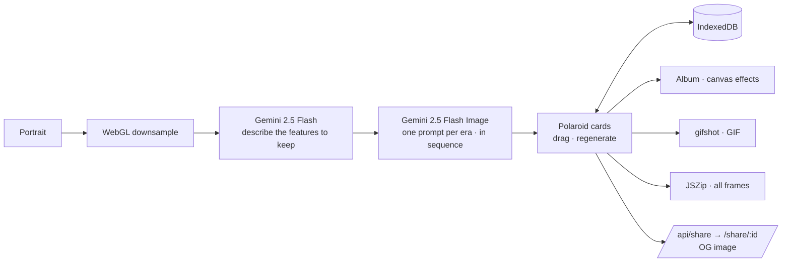

<div align="center">



<p>
  <a href="https://time-shift-eight.vercel.app"></a>
  
  
  
</p>

<p><em>Upload one portrait and see yourself across a century: ten photorealistic polaroids,<br>
from a 1920s flapper to a 2010s phone snap, to arrange, collect and share.</em></p>

</div>


## The idea

A time machine you can hold. TimeShift takes a single photo, works out what makes the face *yours*, and then imagines you living in each decade of the last hundred years: the clothes, the hair, the film stock and the light of the era, with your face kept. The results land on the table as polaroids you can push around like real prints.

> **Identity first.** Before any image is made, Gemini describes the person's features in the uploaded photo. That description travels with every decade prompt, so the 1940s you and the 1990s you are recognisably the same person.


## Features

| | |
|---|---|
| **Ten eras** | 1920s flapper, 1930s Great Depression, 1940s wartime, 1950s classic, 1960s psychedelic, 1970s disco, 1980s neon, 1990s grunge, 2000s Y2K and 2010s early digital. |
| **Identity lock** | A feature analysis of your photo (Gemini 2.5 Flash) is added to every era prompt. |
| **One at a time** | Decades are generated in sequence to stay under rate limits, each card developing as it arrives. |
| **Regenerate** | Not happy with one era? Re-roll just that card. |
| **Draggable polaroids** | Pick up, move and drop the prints with Framer Motion physics and soft shadows. |
| **Sound** | Shutter, upload, success and regenerate sounds, with a mute switch. |
| **Albums** | Grid and collage pages rendered on canvas with none, vintage, black-and-white or sepia effects, ready to download. |
| **GIF and ZIP** | Turn the set into an animated GIF or download every frame in a ZIP. |
| **Share links** | Save a result and get a `/share/:id` page with its own Open Graph image and title. |
| **Fast uploads** | Large photos are downsampled with WebGL before they are sent. |
| **Saved locally** | Results are kept in IndexedDB, so a refresh does not lose your trip. |


## How it fits together




## Türkçe özet

**TimeShift**, tek bir portre fotoğrafını 1920'lerden 2010'lara on farklı döneme ait fotogerçekçi polaroidlere dönüştüren bir deneyim. Önce Gemini yüzünün korunacak özelliklerini çıkarıyor, sonra her dönem için seni o yılların kıyafeti, saçı ve film dokusuyla yeniden çiziyor. Polaroidleri masada sürükleyebilir, beğenmediğin dönemi yeniden üretebilir, sonucu albüm, GIF ya da ZIP olarak indirebilir ve kendi önizleme görseli olan bir bağlantıyla paylaşabilirsin.


## Development

```sh
npm install
cp .env.example .env.local   # VITE_GEMINI_API_KEY
npm run dev                  # Express (share routes) + Vite
npm run build
```

The Gemini key is read on the client as `VITE_GEMINI_API_KEY`; restrict it to your domain in Google AI Studio. The Express server stores shared results in `shares/` and renders their Open Graph tags. `DEPLOYMENT.md` covers Vercel.

```
App.tsx              upload, the decade queue, the polaroid table
components/          landing, polaroid card, share view
services/            geminiService: feature analysis and per-era generation
lib/                 album rendering, GIF, ZIP, WebGL downsample, sounds
server.ts            share API and OG pages
```

<div align="center">
<br>
<a href="https://github.com/kutluhangil"></a>
<sub>All rights reserved · the faces in the banner are drawn placeholders, not real people.</sub>
</div>
