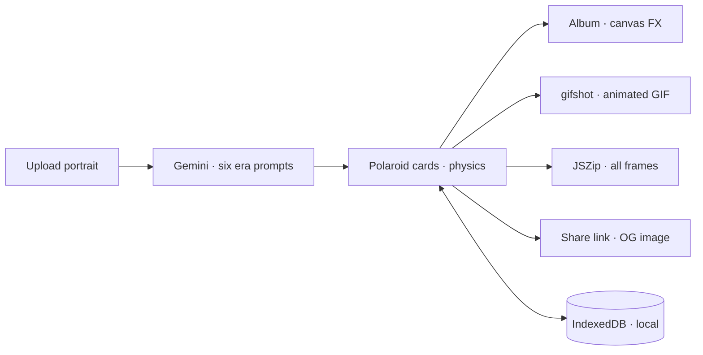

<div align="center">


<p>
  <a href="https://time-shift-eight.vercel.app"></a>
  
  
  
</p>

<p><em>Upload one portrait and watch AI reimagine it as photorealistic vintage polaroids,<br>
from the 1950s to the 2000s, in authentic era-specific style.</em></p>

</div>


## Features

| | |
|---|---|
| **Decade transformation** | One photo, six eras: the 50s, 60s, 70s, 80s, 90s and 00s. |
| **Interactive polaroids** | Drag the cards around with realistic physics, snapping and soft shadows. |
| **Sound** | Subtle shutter clicks and drag sounds. |
| **Albums** | Grid and collage layouts with vintage and sepia effects, rendered on canvas and downloadable. |
| **GIF and ZIP** | Turn the set into an animated GIF or download every frame. |
| **Sharing** | One-click links with generated Open Graph thumbnails. |
| **Premium UI** | Deep blacks, animated mesh gradients and noise textures, on desktop and mobile. |




## Türkçe özet

**TimeShift**, tek bir portre fotoğrafını 1950'lerden 2000'lere altı farklı on yıla ait fotogerçekçi vintage polaroidlere dönüştüren yapay zekâ destekli bir deneyim. Polaroid kartları fizikle sürükleyip dizebilir, sonucu albüm, GIF ya da ZIP olarak indirebilir ve tek tıkla paylaşabilirsin.


## Development

```sh
npm install
cp .env.example .env.local   # GEMINI_API_KEY
npm run dev                  # Express + Vite
npm run build
```

<div align="center">
<br>
<a href="https://github.com/kutluhangil"></a>
<sub>Same face. Different decade.</sub>
</div>
